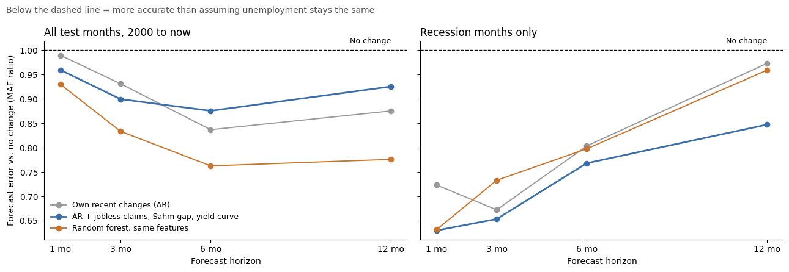
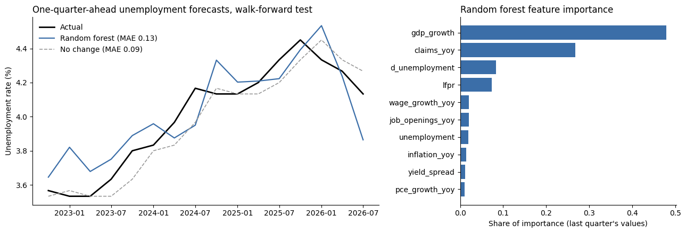

# Forecasting U.S. Unemployment from Labor Market Indicators

Can public labor market indicators forecast the U.S. unemployment rate better than assuming it stays the same?

**Short answer: yes, but only with the right data and setup.**

- **Monthly data from 1977, with weekly jobless claims (Part 2):** every model beat "no change" at every horizon from 1 to 12 months. A random forest cut forecast error by 24% at 6 months and 22% at 12 months. In recession months, a linear model with jobless claims cut error by 37% one month ahead.
- **Quarterly data from 2007 (Part 1):** nothing beat "no change" one quarter ahead, and the random forest was 53% worse. With only 78 quarters and indicators lagged a full quarter, the models had too little data and too-stale signals.

Errors throughout are mean absolute error in percentage points of the unemployment rate. Every test is walk-forward: models train only on data available before each forecast date.

## Part 2: Monthly forecasts at 1 to 12 months (main result)



**Forecast error vs. assuming no change** (below 1.00 = more accurate). Test period January 2000 to September 2026, 597 months of data from 1977; March 2020 to June 2021 excluded.

| Model | 1 month | 3 months | 6 months | 12 months | Recessions, 1 month |
|---|---|---|---|---|---|
| Unemployment's own recent changes (AR) | 0.99 | 0.93 | 0.84 | 0.88 | 0.72 |
| AR + jobless claims, Sahm gap, yield curve | 0.96 | 0.90 | 0.88 | 0.93 | **0.63** |
| Random forest, same features | **0.93** | **0.83** | **0.76** | **0.78** | **0.63** |

For scale, the no-change forecast misses by 0.11 percentage points at 1 month and 0.70 at 12 months. The random forest's 12-month error is 0.55. Full numbers: [`results/monthly_metrics.json`](results/monthly_metrics.json).

**What it shows**
- **Indicators matter more the further out you forecast.** At 1 month, every model is within 7% of "no change", which is close to noise. At 6 to 12 months, the gains reach 22 to 24%.
- **Recessions are where the indicators pay off.** In the 26 recession months tested, jobless claims cut 1-month error by 37% and 3-month error by 35%. That's when a forecast is most valuable.
- **The random forest wins overall with 600 months of data,** reversing Part 1, where 78 quarters were too few for it to learn from. Near turning points, the claims-based linear model does as well or better.

**Setup:** monthly unemployment, weekly initial jobless claims averaged to months, the 10-year minus 2-year Treasury spread, and NBER recession dates, all from FRED. The features are the last 1 and 3 months' change in unemployment, a Sahm-rule-style gap (the 3-month average minus the 12-month low), and the 3- and 12-month change in claims. Models predict the change in unemployment h months ahead and are re-estimated once a year.

## Part 1: Quarterly forecast, one quarter ahead

| Model | Mean absolute error (pct points) | vs. no change |
|---|---|---|
| Linear ridge | 0.083 | −2% |
| No change (baseline) | 0.085 | — |
| Random forest | 0.131 | +53% |

Walk-forward test over 16 quarters (2022 Q4 to 2026 Q3); 78 usable quarters from 2007 Q2, limited by the average hourly earnings series, which starts in 2006. The data is 9 FRED series averaged to quarters, each lagged one quarter. Full output: [`results/metrics.json`](results/metrics.json).



The random forest leaned mostly on GDP growth (48% of importance) and the change in jobless claims (27%). Both swung furthest in 2008 and 2020, so the model likely learned those extremes and overreacted to ordinary quarters. Ridge's 2% edge over 16 quarters is within noise.

## Run it

Open the notebook in Google Colab, or locally run:

```
pip install -r requirements.txt
jupyter notebook labor_market_forecast.ipynb
```

No API key is needed: the data comes from FRED's public CSV downloads. Part 2 takes a few minutes to run.

## Limits

- **Recession results rest on 26 months** across two recessions (2001 and 2008–09), so treat them as suggestive.
- **1-month differences are small** (under 7%) and may not hold out of sample.
- **Revised data:** FRED serves today's revised figures, not what forecasters saw at the time, so real-time accuracy would be somewhat worse.
- **COVID is excluded** from Part 2, so these results don't say how the models would handle a shock of that size.
- **Feature importance** shows what a model relies on, not cause and effect.

Next steps: add labor force flows (Barnichon and Nekarda, 2012) and benchmark against the Philadelphia Fed's Survey of Professional Forecasters.

Data: [Federal Reserve Bank of St. Louis, FRED](https://fred.stlouisfed.org/).
